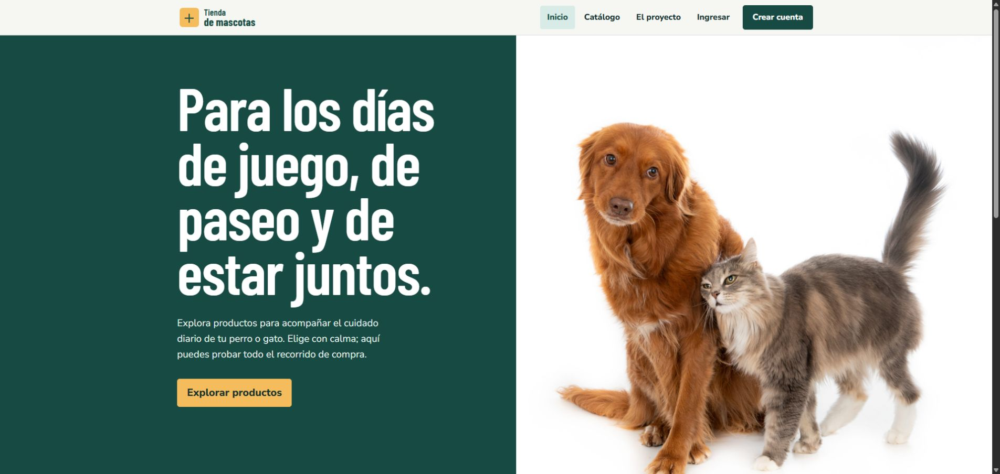
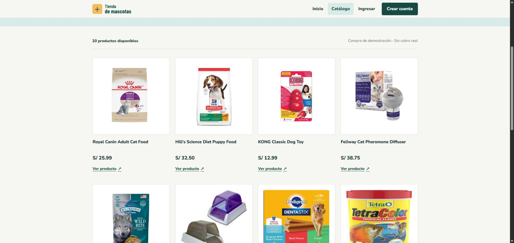
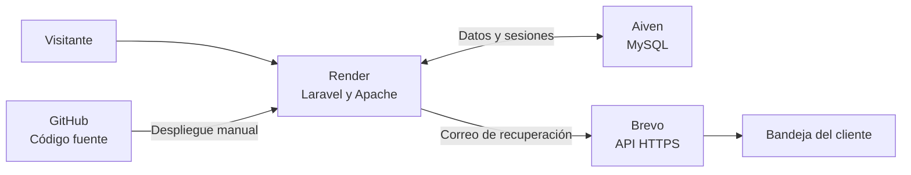

<div align="center">
  <h1>Tienda Veterinaria</h1>
  <p>Una tienda de productos para mascotas, desde el catálogo hasta una compra simulada.</p>
  <p>
    <a href="https://tienda-mascotas-demo-mmoh.onrender.com"><strong>Visitar la tienda</strong></a>
    &nbsp;·&nbsp;
    <a href="https://tienda-mascotas-demo-mmoh.onrender.com/catalogo">Explorar el catálogo</a>
    &nbsp;·&nbsp;
    <a href="#ejecución-local">Ejecutar en local</a>
  </p>
  <p>
    
    
    
    
  </p>
</div>

<p align="center">
  <a href="https://tienda-mascotas-demo-mmoh.onrender.com">
    
  </a>
</p>

## El proyecto

Tienda Veterinaria es una aplicación de comercio electrónico construida con Laravel. Permite recorrer el catálogo sin registrarse y completar, con una cuenta de prueba, el flujo de carrito, compra, historial y factura. Incluye un área de administración para mantener productos y proveedores.

> **La compra es una simulación.** Se registra el método elegido para mostrar el flujo completo, pero no hay pasarela de pago, cobros ni pedidos reales.

| Quién entra | Qué puede hacer |
| --- | --- |
| Visitante | Explorar el catálogo, buscar productos y consultar sus detalles. |
| Cliente | Crear una cuenta, iniciar sesión, editar su perfil, usar el carrito, registrar una compra simulada, consultar su historial y factura, y recuperar su contraseña. |
| Administrador | Revisar el panel, clientes y ventas; crear, editar y gestionar productos y proveedores. |

<details>
<summary><strong>Ver el catálogo y un recorrido sugerido</strong></summary>

<br>



1. Abre el [catálogo público](https://tienda-mascotas-demo-mmoh.onrender.com/catalogo) y busca un producto.
2. Crea una cuenta de prueba para añadir productos al carrito.
3. Confirma una compra simulada y revisa el historial y la factura.
4. Desde tu perfil, prueba la edición de datos o la recuperación de contraseña.

</details>

## Arquitectura



- **Render** ejecuta la aplicación Docker y sirve las páginas. Los despliegues se lanzan manualmente desde `main`.
- **Aiven MySQL** conserva cuentas, catálogo, carritos, compras, sesiones e imágenes nuevas. La conexión verifica el certificado TLS.
- **Brevo** envía los correos de recuperación de contraseña mediante su API HTTPS.

La interfaz usa Blade, Bootstrap y estilos propios. Las migraciones de MySQL crean tablas, disparadores, procedimientos y una vista; la compra se registra dentro de una transacción. El proyecto usa PHP 8.3, Laravel 13 y MySQL 8. El `Dockerfile` define el entorno de producción; los recursos de la interfaz actual están versionados en `public/dist`.

## Ejecución local

Necesitas **PHP 8.3 o superior**, Composer 2, **MySQL 8** y la extensión PHP `pdo_mysql`. Crea primero una base MySQL **vacía**. Las migraciones necesitan permisos para crear disparadores, procedimientos y vistas. SQLite no es compatible con este proyecto.

1. Instala dependencias y prepara la configuración:

   ```bash
   composer install
   cp .env.example .env
   php artisan key:generate
   ```

   En PowerShell, sustituye `cp` por `Copy-Item .env.example .env`.

2. Configura `.env` para tu base local. Como mínimo, revisa estos valores:

   ```dotenv
   APP_ENV=local
   APP_URL=http://127.0.0.1:8000
   DB_CONNECTION=mysql
   DB_HOST=127.0.0.1
   DB_PORT=3306
   DB_DATABASE=tienda_mascotas_virtual
   DB_USERNAME=root
   DB_PASSWORD=
   MAIL_MAILER=log
   ```

3. Crea el esquema y los datos de ejemplo, e inicia la aplicación:

   ```bash
   php artisan migrate --seed
   php artisan serve
   ```

Abre <http://127.0.0.1:8000>. Si trabajas con imágenes antiguas guardadas en `storage/app/public/products`, ejecuta también `php artisan storage:link`. Las imágenes nuevas que sube el administrador se guardan en MySQL para sobrevivir a los reinicios del servidor.

<details>
<summary><strong>Cuentas y correo de prueba en local</strong></summary>

La siembra crea `admin@example.test` y `cliente1@example.test`, ambas con la contraseña `DemoPass123!`, **solo** cuando `APP_ENV` es `local` o `testing`. No se crean en producción.

Con `MAIL_MAILER=log`, el enlace de recuperación de contraseña se escribe en `storage/logs/laravel.log`; no se envía un correo real.

</details>

<details>
<summary><strong>Compilar recursos y ejecutar pruebas</strong></summary>

Node.js y npm solo son necesarios si vas a trabajar en los recursos de Vite. La interfaz actual también dispone de archivos versionados en `public/dist`.

```bash
npm ci
npm run build
composer audit --locked --no-dev
npm audit --audit-level=moderate
```

Las pruebas de base de datos requieren una **segunda base local descartable** cuyo nombre termine en `_test`. Antes de ejecutar `migrate:fresh`, comprueba la conexión: ese comando elimina todas las tablas de la base seleccionada. Ejemplo en PowerShell:

```powershell
$env:APP_ENV = 'testing'
$env:DB_CONNECTION = 'mysql'
$env:DB_HOST = '127.0.0.1'
$env:DB_PORT = '3306'
$env:DB_DATABASE = 'tienda_mascotas_test'
$env:DB_USERNAME = 'root'
$env:DB_PASSWORD = ''
php artisan migrate:fresh --seed --force
php artisan test
```

La última ejecución documentada completó **26 pruebas y 212 aserciones**. Las comprobaciones de dependencias y compilación están detalladas en la [auditoría de seguridad](docs/security-audit-2026-10-19.md).

</details>

## Despliegue y seguridad

La [instancia pública](https://tienda-mascotas-demo-mmoh.onrender.com) usa un servicio web **Render Free**, una base **Aiven MySQL Free** y **Brevo Free** para el correo. El despliegue es manual y Auto-Deploy está desactivado. La primera visita después de un período de inactividad puede tardar en responder.

La configuración sensible vive en variables privadas de Render; `.env`, contraseñas, claves API y el certificado CA no se publican en Git. El registro, las compras simuladas y los correos de recuperación tienen límites para reducir el abuso y el crecimiento de la base. Hay controles de acceso por rol, protección CSRF, cookies de sesión seguras en producción y validación de imágenes. Estas medidas están descritas junto con sus límites en la [auditoría de seguridad](docs/security-audit-2026-10-19.md).

Para reproducir el despliegue, configurar secretos y comprobar los planes gratuitos, consulta la [guía de Render, Aiven y Brevo](docs/deploy-render-aiven.md). El código no puede garantizar por sí solo que un proveedor externo nunca cobre; revisa los planes, el uso y los métodos de pago de cada cuenta antes de desplegar una copia.

## Autoría y uso

**© 2026 Alex Alcantara. Todos los derechos reservados sobre el código original y la documentación de este proyecto.** El repositorio es público para mostrar y evaluar el trabajo; su publicación no concede permiso para copiarlo, modificarlo o redistribuirlo. Las dependencias y los recursos de terceros conservan sus propias condiciones. Las imágenes de la demostración se publican con permiso, pero ese permiso no se extiende automáticamente a terceros.
